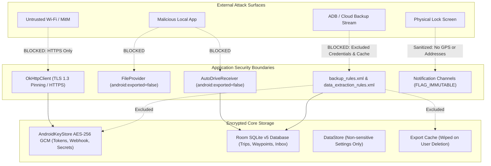

# Phase 4 — Security Threat Model & Data Protection Architecture

**Application:** Business Mileage Tracker (`com.businesstracker.mileage`)  
**Package Name:** `com.businesstracker.mileage`  
**Security Target:** IRS-Compliant Business Mileage Tracking, GPS History & OAuth Data Protection  
**Document Version:** 1.0 (Phase 4 Hardening)  
**Date:** 2026-11-06  

---

## 1. Executive Summary & Security Objectives

The Business Mileage Tracker application records sensitive personal movements, fine-grained GPS coordinate fixes, commercial travel purposes, tax deductions, and Google Cloud credentials. Compromise of this data could lead to physical surveillance, corporate espionage, unauthorized cloud spreadsheet modification, or loss of tax compliance records.

The primary objective of **Phase 4** is to eliminate attack surfaces, harden inter-process communications, migrate all sensitive tokens to hardware-backed cryptography, protect backup boundaries, implement user-controlled data erasure, and prevent data loss during interruptions or device migrations—**without sacrificing automatic tracking or existing historical trip records**.

---

## 2. Protected Assets & Data Classification

| Asset ID | Asset Name | Sensitivity Level | Storage Location | Protection Mechanism |
| :--- | :--- | :---: | :--- | :--- |
| **AST-01** | GPS Coordinates & Waypoint Trail | **CONFIDENTIAL** | SQLite (`active_waypoints`, `gps_inbox`) | Android Linux UID Sandbox, No Coordinate Logging |
| **AST-02** | Finalized Trip Records & IRS Deductions | **CONFIDENTIAL** | SQLite (`trips`) | Room Database v5, Android Sandbox, Backup Retention |
| **AST-03** | Google OAuth Access & Refresh Tokens | **RESTRICTED** | `mileage_secure_credentials.xml` | `AndroidKeyStore` AES-256 GCM, Unique 96-bit IV, 128-bit Tag |
| **AST-04** | Google Sheets Webhook Deployment URL | **RESTRICTED** | `mileage_secure_credentials.xml` | `AndroidKeyStore` AES-256 GCM, Excluded from Backup |
| **AST-05** | Cloudflare Client Secret & Bearer Token | **RESTRICTED** | `mileage_secure_credentials.xml` | `AndroidKeyStore` AES-256 GCM, Excluded from Backup |
| **AST-06** | Exported PDF & CSV Tax Reports | **CONFIDENTIAL** | `context.cacheDir/exports/` | `FileProvider` (unexported), Explicit Backup Exclusion, User Purge |
| **AST-07** | Work Schedule & General Settings | **INTERNAL** | `tracking_prefs.preferences_pb` | Jetpack DataStore (stripped of all secrets) |

---

## 3. Threat Actors & Attack Surfaces

### 3.1 Threat Actors
1. **Malicious 3rd-Party App (Local Untrusted App):** An unprivileged application installed on the same Android device attempting to spoof intents, snoop broadcasts, or access shared storage.
2. **Network Eavesdropper / MitM:** An adversary monitoring public Wi-Fi or cellular traffic attempting to intercept sync payloads or OAuth tokens.
3. **Physical Device Thief / Observer:** An unauthorized person who acquires physical possession of an unlocked device or inspects notifications.
4. **Cloud / Backup Compromise:** An attacker gaining access to unencrypted ADB backups, cloud backups, or device-to-device migration streams.
5. **System Instability / Process Interruption:** Kernel OOM kills, device reboot, or battery death occurring during credential migration or database writes.

### 3.2 Attack Surface Analysis

---

## 4. Security Boundaries & Controls

### 4.1 Component Hardening (GAP-01)
- **Problem:** `AutoDriveReceiver` was previously declared with `android:exported="true"`, allowing any app on the phone to broadcast spoofed vehicle transition intents.
- **Hardening:** Changed to `android:exported="false"`.
- **Delivery Mechanism:** Google Play Services `ActivityRecognitionClient` receives an **explicit PendingIntent** created via `Intent(context, AutoDriveReceiver::class.java)`. Because the intent is explicit to this application's package, Android delivers the callback directly to the unexported receiver while preventing all external applications from sending broadcasts to it.
- **Defensive Extraction:** `AutoDriveReceiver.onReceive()` enforces `ActivityTransitionResult.hasResult(intent)` and discards empty or malformed intents immediately.

### 4.2 Preference Encryption & Safe Migration (GAP-02)
- **Problem:** Webhook URLs and Cloudflare secrets were stored in plaintext DataStore (`tracking_prefs.preferences_pb`), making them vulnerable to backup extraction.
- **Hardening:** Moved into `SecureStorageManager` using `AndroidKeyStore` AES-256 GCM.
- **Fail-Closed Architecture:**
  - AES-256 encryption using hardware HSM when available.
  - Unique 96-bit (12-byte) initialization vector (IV) and 128-bit authentication tag per write.
  - Never falls back to plaintext, simple Base64, or software keys in production.
- **Mandatory Safe Migration Procedure:**
  1. Concurrency-locked via `Mutex` to guarantee thread safety.
  2. Reads legacy plaintext value from DataStore.
  3. Encrypts into `SecureStorageManager`.
  4. Reads back and verifies successful authenticated decryption (`get() == plain`).
  5. Only after verification, deletes the plaintext DataStore entry.
  6. If verification fails, **preserves the plaintext value in DataStore** and flags a recoverable error. Zero credential loss.

### 4.3 Backup & Data Extraction Hardening (GAP-03)
- **Rules Configuration:** Both `backup_rules.xml` (API <= 30) and `data_extraction_rules.xml` (API >= 31) enforce:
  - `<exclude domain="sharedpref" path="mileage_secure_credentials.xml" />`
  - `<exclude domain="file" path="exports" />`
  - `<exclude domain="root" path="cache" />`
- **Database Preservation Decision:**
  - `databases/EXPENSE_TRACKER_DB` is **retained** in backup.
  - *Risk Analysis:* Excluding the database would cause legitimate users restoring a phone or transferring to a new device to permanently lose 100% of their historical business tax deduction records.
  - *Mitigation:* Because all credentials and webhook URLs are strictly separated into `mileage_secure_credentials.xml` (which is excluded from backup), backup data contains zero access tokens or webhook secrets.

### 4.4 User-Controlled Data Erasure & Privacy (GAP-04)
- **Feature:** "Delete All Trip Data" in Settings with a mandatory **two-stage confirmation dialog**.
- **Atomic Deletion:** Room `@Transaction` in `TripDao.clearAllLocalTripData()` simultaneously wipes:
  - `trips`
  - `active_trip`
  - `active_waypoints`
  - `gps_inbox`
  - `trip_lifecycle`
  - `trip_sequence`
- **Cache Cleanliness:** Automatically clears `context.cacheDir/exports/`, removing all generated PDF and CSV summaries.
- **Active Drive Guard:** Deletion is blocked if `LocationTrackingService.serviceState.value.isTracking` is true, preventing corrupt state during an active drive.
- **Non-Destructive Independence:**
  - Google OAuth credentials remain intact.
  - Webhook URL and Cloudflare tokens remain intact.
  - Remote Google Sheets records are **never** deleted (offline/local erase only).
  - Google OAuth disconnect clears OAuth tokens but **never deletes local SQLite trips**.

---

## 5. Threat Matrix & Residual Risks

| Threat Scenario | Implemented Protection | Verification Status | Residual Risk & User Guidance |
| :--- | :--- | :---: | :--- |
| **Spoofed Drive Transitions** | `AutoDriveReceiver` set to `exported="false"`; explicit PendingIntent; result validation. | **Verified by Automated Tests** | None from unprivileged apps. |
| **Credential Theft via Backup** | `mileage_secure_credentials.xml` excluded from Cloud Backup & Device Transfer. | **Verified by Configuration & Unit Tests** | User must re-authenticate on new device (by design). |
| **Plaintext Secret Leakage** | Webhook URLs and API secrets encrypted via AES-256 GCM in `AndroidKeyStore`. | **Verified by Automated Tests** | None on standard unrooted devices. |
| **Rooted Device Compromise** | Memory inspection or su SQLite reading. | **Architecture Boundary** | On rooted devices, root users can inspect SQLite files. Users should avoid running banking/tax apps on compromised firmware. |
| **Interrupted Migration** | Mutex synchronization; verify-before-delete; plaintext preserved on failure. | **Verified by Automated Tests** | Zero data loss. |
| **Accidental Local History Loss** | Two-step explicit dialogs; Google disconnect preserves local trips; backup preserves database. | **Verified by Automated Tests** | Users must intentionally confirm twice before local history is erased. |
